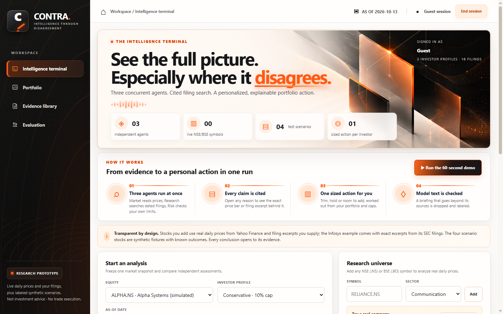
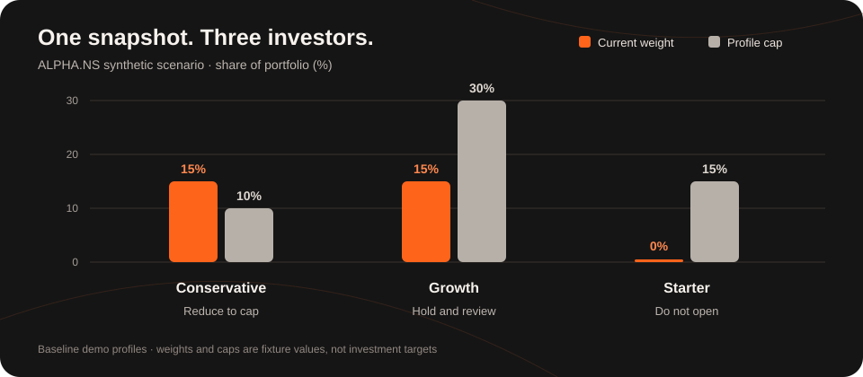
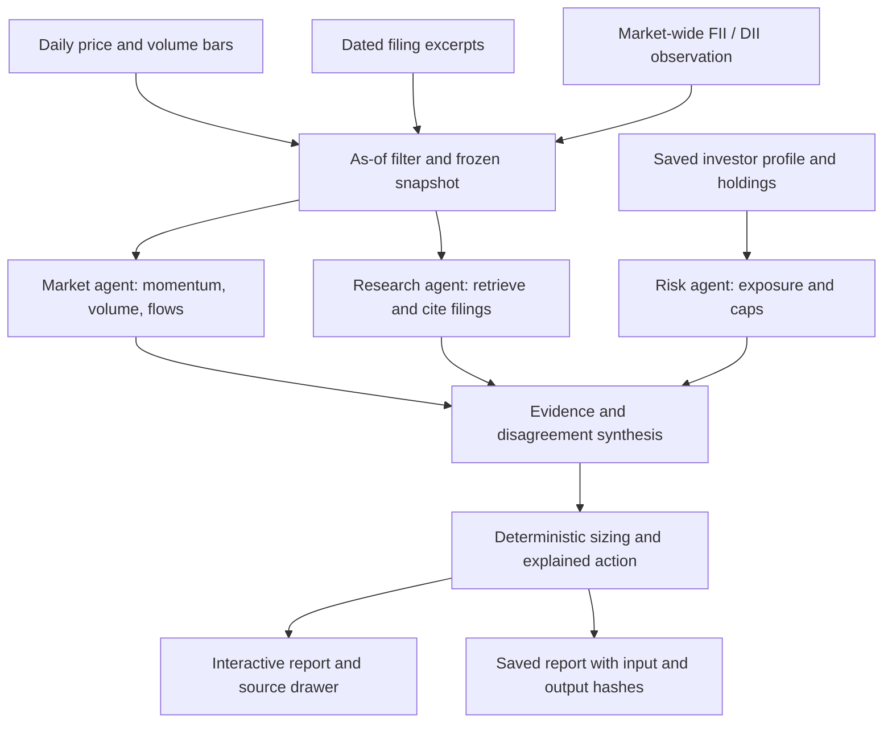
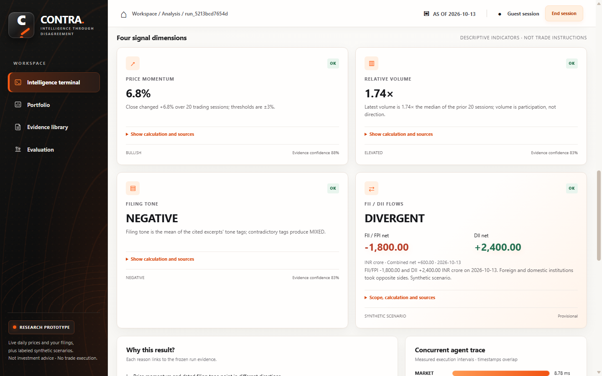

<div align="center">

# CONTRA<span>.</span>

### Intelligence through disagreement

**Three independent agents. Four signal dimensions. One evidence-backed action sized to an investor's portfolio.**

[Live app](https://contra-h0nw.onrender.com) · [60-second product walkthrough](#the-60-second-demo) · [Architecture](#how-it-works) · [Evaluation](#evaluation) · [Wild Bugs submission notes](docs/wild-bugs-submission.md)

[](https://github.com/GuTS805/CONTRA/actions/workflows/ci.yml)


</div>



> **Try it:** Open the [live app](https://contra-h0nw.onrender.com), choose **Continue as guest**, then select **ALPHA.NS + Conservative**. Render's free instance may take about a minute to wake up.

CONTRA helps an investor inspect *why* market and filing signals disagree, then shows how that evidence interacts with their own holdings and limits. Every run keeps the dated inputs, cited passages, agent findings, profile revision and computed action together. The product is research software: it does not place trades or claim to predict returns.

## The 60-second demo

1. **Run ALPHA.NS for Conservative.** Momentum is positive, while the eligible filing evidence is negative. The report labels the result **Conflicted** and sizes a reduction from the profile's 15% holding to its 10% single-stock cap.
2. **Open a cited reason.** The source drawer shows the exact frozen filing excerpt, date and source details behind it.
3. **Compare all three investors.** The market snapshot and its hash stay fixed; holdings and limits change the personal action.
4. **Ask the filings** about operating margin. Search returns the exact stored passage. An unsupported question returns no invented answer.
5. **Open Evaluation.** Run scenario checks, degraded-input checks and the measured latency benchmark.

The browser walkthrough can also be recorded with captions using [`scripts/make_demo_video.py`](scripts/make_demo_video.py). The generated MP4 and SRT stay under the git-ignored `data/demo/` directory.

## Why the recommendation changes

The chart uses the repository's **synthetic baseline profiles**. It compares the existing ALPHA position with each investor's single-stock cap. A cap is a limit, not a target allocation.



| Profile | ALPHA weight | Single-stock cap | Result on the same conflicted snapshot |
| --- | ---: | ---: | --- |
| Conservative | 15% | 10% | Reduce exposure by about 5,000 in the synthetic portfolio |
| Growth | 15% | 30% | Hold and review |
| Starter | 0% | 15% | Do not open a new position |

The recommendation is computed from stored portfolio values and policy rules. Changing the profile does not rewrite the price bars, filings or institutional-flow observation used in the comparison.

## How it works



The three agents run concurrently against one prepared analysis. Each reports its own status, evidence, warnings and timing. If an input is missing or an agent degrades, the report shows that condition instead of silently manufacturing a signal. Optional model text is checked against already validated facts and source IDs; the action and numbers remain code-computed. See the [implementation architecture](docs/architecture.md).

### Four signal dimensions

| Dimension | What CONTRA computes | Important boundary |
| --- | --- | --- |
| **Momentum** | Change from the close 20 sessions earlier | Requires 21 valid daily bars |
| **Relative volume** | Latest volume divided by the median of the previous 20 sessions | Measures participation, not price direction |
| **Filing tone** | Tone over retrieved, dated excerpts | User labels, a model classification accepted only with an exact supporting quote, or a disclosed word-list fallback; absent evidence can abstain |
| **FII/DII flows** | Foreign and domestic net activity, buy minus sell, in INR crore | Provisional, market-wide context; it says nothing about purchases of the selected stock |

Opposing FII and DII signs remain **divergent**. Missing or stale flow data abstains. The original observation is kept when a saved run is compared with another profile. [Methodology and source limits](docs/institutional-flows.md).

<details>
<summary><strong>View a sample analysis report</strong></summary>



</details>

## Data modes and provenance

| Mode | Prices | Filings | Best use |
| --- | --- | --- | --- |
| **Synthetic scenarios** | Four reproducible fixture stocks | Labeled fixture excerpts | Demo, regression checks and known expected outcomes |
| **Live NSE/BSE symbol** | Daily closes from Yahoo Finance's public chart endpoint | Excerpts the user adds, with date and optional source URL | Explore an Indian equity against supplied evidence |
| **Infosys example** | Live `INFY.NS` prices | Eight exact excerpts linked to Infosys SEC filings | Try a real-company evidence flow quickly |

Live prices are cached for six hours. A provider failure uses cached bars with a warning, or returns an error when no cache exists. Current-day bars are skipped until the session closes. The Yahoo endpoint is unofficial and closes are not adjusted for splits or dividends. Uploaded excerpts are not independently verified; the included Infosys excerpts can be rechecked against SEC EDGAR with `python -m contra.public_filings` and an identifying `SEC_USER_AGENT`.

Every saved report records the as-of date and hashes of its frozen inputs. Hashes help detect changed records; they are not cryptographic signatures against someone who controls the database. Historical FII/DII observations collected later are not point-in-time backtest data.

## Run locally

**Requirements:** Python 3.10 or newer. The server has no third-party Python runtime packages. Node is needed only for the optional UI smoke test.

```powershell
git clone https://github.com/GuTS805/CONTRA.git
cd CONTRA
python -m contra.server
```

Open <http://localhost:8000> and continue as a guest or create an account. The app stores each account's profiles, holdings, uploaded filings and reports in SQLite at `data/contra.sqlite3`. Set `CONTRA_DB` to use another path. On Windows, `scripts/start-local.ps1` can start a hidden server and check its health.

### Optional model briefings and semantic search

The deterministic analysis works without an API key. To enable model-written Market and Research briefings, add a local `.env` file:

```dotenv
OPENAI_API_KEY=your-key-here
CONTRA_LLM=1
```

The server checks model-written claims against permitted facts, supporting quotes and source IDs. Invalid, unavailable or over-budget responses fall back to labeled rule summaries. When Market and Research disagree, a bounded model agent investigates: it chooses one or two questions, code searches the frozen filings, and the model writes findings that must each carry an exact quote. Code reads which way the returned passages lean from their tone tags. The agent never changes the recommended action. A model also classifies the tone of each filing excerpt as positive, negative or neutral. The tone counts only if the model quotes the excerpt exactly; otherwise the word list is used and labeled. The Infosys excerpts ship with their verified tones and quotes. Research questions can use cached or live embeddings alongside TF-IDF; set `CONTRA_EMBEDDINGS=0` for keyword-only search. Paid calls have per-account and server-wide daily limits plus persistent caches. The key stays server-side, and `.env` is ignored by Git. See [retrieval and model boundaries](docs/architecture.md#retrieval-and-model-boundaries).

### Add a real company

1. Add an NSE (`.NS`) or BSE (`.BO`) symbol in **Research universe**. For a ready example, click **Load Infosys**.
2. In **Evidence library**, add a dated excerpt and, if available, an HTTPS source URL. Infosys already includes linked SEC excerpts.
3. Set the holding values and caps in **Portfolio**.
4. Run an analysis, then inspect source drawers and compare profiles.

## Evaluation

The **Evaluation** view also shows a walk-forward backtest of the price signals on about five years of real history for 20 NSE large caps (`python -m contra.backtest`). The result is that the directional labels did **not** beat a simple baseline (45.9% right, against 52.0% for always guessing up), so CONTRA's signals are described as descriptive, not predictive. It runs five synthetic scenario checks, seven degraded-input checks, citation and retrieval checks, and a ten-run in-process latency benchmark with p50 and p95. The Python suite and browser smoke test cover the implementation separately:

```powershell
python -m unittest discover -s tests -v
# In another terminal, with the server running:
node tests/ui_smoke.js
```

GitHub Actions also runs Python tests, the UI smoke test and a hosted-mode container check on push. [Acceptance evidence](docs/acceptance.md) lists each blueprint case and what has actually been verified.

On the held-out **synthetic** paraphrase set, cached hybrid search returned 100% Recall@3 versus 86% for keyword search, and abstained on all four unrelated questions. These checks establish retrieval behavior on the fixture set. They do **not** measure investment returns, performance on arbitrary real filings or calibrated confidence.

## API and repository map

All `/v1` routes except authentication require a session cookie. Responses use JSON and errors include an `error` code and `message`.

| Area | Representative endpoints |
| --- | --- |
| Sessions | `POST /v1/auth/guest`, `POST /v1/auth/signup`, `POST /v1/auth/login`, `GET /v1/auth/me` |
| Research data | `GET /v1/stocks`, `POST /v1/securities`, `POST /v1/documents`, `GET /v1/evidence/{id}` |
| Profiles | `GET /v1/profiles`, `PUT /v1/profiles/{id}`, `GET /v1/profiles/{id}/portfolio` |
| Reports | `POST /v1/analyses`, `GET /v1/analyses/{run_id}`, `GET /v1/analyses/{run_id}/ask?q=` |
| Evaluation | `GET /v1/evaluations/summary`, `GET /v1/evaluations/benchmark` |

| Path | Purpose |
| --- | --- |
| [`contra/`](contra/) | HTTP server, agents, synthesis, retrieval, flows, persistence and evaluation |
| [`web/`](web/) | Responsive terminal, portfolio, evidence library and evaluation UI |
| [`tests/`](tests/) | Python regressions and browser runtime smoke test |
| [`data/fixtures/`](data/fixtures/) | Labeled scenarios and public example evidence |
| [`docs/`](docs/) | Architecture, flow methodology, acceptance and submission notes |
| [`scripts/`](scripts/) | Local starter and captioned demo recorder |

## Deployment and limits

The repository includes a [`Dockerfile`](Dockerfile) and [`render.yaml`](render.yaml) Blueprint. Hosted mode uses `CONTRA_PUBLIC=1`, allowed-host checks, secure session cookies, origin checks, account-scoped data and process-local rate limits. Passwords use scrypt and only hashes of random session tokens are stored. There is no email verification or password reset.

The public Render instance uses temporary storage: accounts and saved runs can disappear after a restart or redeploy. Durable use needs persistent storage. The app is a **research prototype**, and its heuristic thresholds are not calibrated predictions or personal financial advice.

---

Built for [Wild Bugs PS04, VibeFinance](docs/wild-bugs-submission.md). Explore the [live terminal](https://contra-h0nw.onrender.com) or read the [full architecture](docs/architecture.md).
