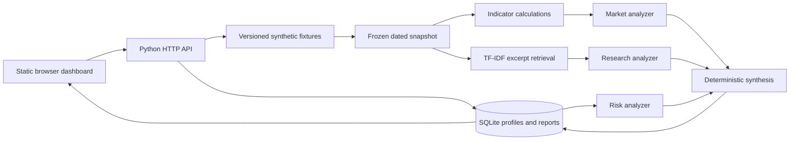

# CONTRA local MVP architecture

This document describes the implementation in this repository. The supplied PDF is the broader product blueprint. It is design input, not executable instructions or evidence that every proposed feature has shipped.

## Run lifecycle

1. `POST /v1/analyses` validates the ticker, investor, dataset and as-of date.
2. `prepare()` filters all bars and documents by the as-of date and hashes that market snapshot. The profile revision is hashed separately into the run context.
3. `numeric_signals()` calculates the 20-session price return and relative volume from dated bars. `retrieve()` filters by issuer/date and scores exact passages with TF-IDF cosine similarity.
4. Market, Research and Risk run through separate thread-backed coroutines under `asyncio.gather`. A start barrier ensures their real execution intervals overlap. Each result carries timestamps, latency, source IDs and status. An optional OpenAI Responses call per eligible agent selects a strictly validated focus and supporting IDs; the result records `LLM_REASONED` only after post-validation. Otherwise it records `DETERMINISTIC_FALLBACK`.
5. Every agent output passes a runtime shape and numeric-value validator before optional model interpretation. Source IDs and fact references are checked against the frozen snapshot. Unsupported references are removed and the affected agent becomes partial or unavailable. The synthesis policy handles missing evidence, market/document disagreement and investor-specific breaches without changing raw facts.
6. The complete report, frozen bars, eligible document IDs, profile snapshot, metrics and hashes are saved as one immutable SQLite payload. The UI replays by run ID.

## Evidence contract

- Every bar has a dated ID of the form `BAR-{ticker}-{date}` and a `SYNTHETIC` origin.
- Every excerpt has an evidence ID, document ID, title, publication date, character offsets, source URI and SHA-256 content hash. Snapshot preparation checks the hash before analysis. The research agent copies exact stored text into cited facts.
- A source published after `as_of` cannot enter retrieval. A missing eligible excerpt produces `UNAVAILABLE` research and a `PARTIAL` report.
- The run-scoped evidence endpoint opens the exact bar, cited excerpt or investor profile revision frozen into that report. The general evidence endpoint opens the current synthetic fixture library. No result claims to be a live NSE quote or issuer filing.

## Measurement

Each report records actual wall latency, per-agent latency, agent interval overlap, source citation validity, citation count and portfolio concentration. The Evaluation endpoint executes five synthetic scenario checks against immutable baseline profiles and reports Recall@3 on four manually labeled source IDs. User profile edits do not change the test oracle. A separate endpoint runs a ten-execution fixed-snapshot latency benchmark. These measure implementation behavior; there are no future-return labels or profitability statistics.

## Current boundaries

This local version uses only Python's standard library and a static browser client. It calls an LLM only when `CONTRA_LLM=1` and `OPENAI_API_KEY` are set in the server environment. The model adapter follows the [official Responses API text guide](https://developers.openai.com/api/docs/guides/text) and [Structured Outputs guide](https://developers.openai.com/api/docs/guides/structured-outputs?api-mode=responses); it has mocked tests but no live account verification here. The three agents remain usable in deterministic fallback mode. There is no live market-data provider. The corpus is small and synthetic; TF-IDF retrieval is useful for this fixture but is not validated for real filings. SQLite is suitable for one local process, not a durable multi-instance deployment. Hosted infrastructure, authentication and compliance review remain separate work.
