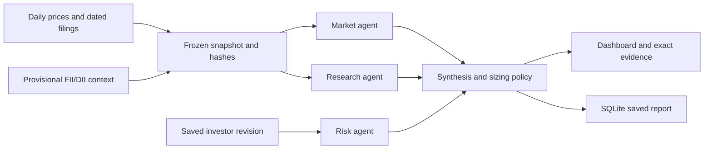

# CONTRA architecture

CONTRA implements Wild Bugs PS 04, VibeFinance. The supplied blueprint is design context; this document describes the code that exists.

## End-to-end pipeline

1. The standard-library HTTP server serves the browser client and session-authenticated JSON API. Account-owned profiles, filings, symbols and reports are isolated in SQLite.
2. Synthetic scenarios or daily Yahoo Finance bars enter `core.prepare`. Bars and filings are filtered by the requested date. The latest eligible institutional-flow observation is included for live runs; synthetic runs use a labeled fixture.
3. Source provenance is validated. Snapshot hashes cover bars, documents and flow observations. Report hashes also cover profile revision, outputs and metrics. Checksums detect changes; they are not signatures against an attacker who controls the database and can rewrite hashes.
4. Market, Research and Risk run in parallel worker threads synchronized by a barrier. Each emits a validated status, assessment, cited facts, confidence, warnings and timing interval. Timeout or invalid output produces a typed degraded result.
5. Market calculates momentum and relative volume plus aggregate institutional-flow facts. Research retrieves dated excerpts and evaluates their disclosed tone tags. Risk computes position weight, sector weight and portfolio concentration from the investor's saved holdings.
6. Optional model interpretation operates only on validated facts and permitted source IDs. Unsupported citations and unsuitable summaries are rejected. Deterministic fallback stays usable and is labeled. Risk sizing is always computed in code.
7. Synthesis detects conflict, missing evidence and risk breaches. Recommendation amounts use original portfolio values, never rounded display percentages. Additions are bounded by cash and exposure limits. If selling the selected stock cannot clear a sector breach, the report explicitly states the remaining excess.
8. Reports are saved with exact inputs. Source drawers read run-scoped evidence. Comparison requests use an owned `source_run_id` to reuse the original bars, filings and flow observation.

## Signal and evidence contracts

| Dimension | Calculation and limitations |
| --- | --- |
| Momentum | Latest close / close 20 sessions earlier minus one. Bullish above +3%, bearish below -3%. Requires 21 valid bars. |
| Relative volume | Latest volume / median previous 20 sessions. Elevated above 1.5, suppressed below 0.7. Participation, not direction. |
| Filing tone | Mean tone tag over retrieved, eligible excerpts. Positive above +0.2, negative below -0.2; otherwise mixed. Tags are synthetic annotations, user labels or a disclosed word-list heuristic. |
| FII/DII flows | Provisional combined NSE/BSE/MSEI capital-market activity. Each net is buy minus sell. Opposite signs remain divergent. Missing or more than four-calendar-day-old observations abstain. No claim of buying in the analyzed stock. |

The first three dimensions expose evidence-confidence components: coverage, freshness, threshold margin and source quality. The weighted score is a heuristic, not a calibrated probability of profitable returns. Flow context has no invented confidence percentage.

Every filing stores the exact excerpt, date, locator, source URI and content hash. Price bars retain provider, date and provenance. Flow observations retain original provider rows, observation time, scope and units. Full methodology: [institutional-flows.md](institutional-flows.md).

## Retrieval and model boundaries

Tone retrieval uses repeatable TF-IDF, stopword removal and plural folding, with a 180-day eligible filing window. Ask the filings can use cached or live embeddings plus TF-IDF, and returns exact passages rather than generated answers. Without embeddings it falls back to keyword retrieval and reports the mode.

Optional Market and Research model briefings must use eligible sources. Research summaries must provide supporting quotes, with topic, direction, quality and negation checks. Invalid responses fall back. Model output never changes measured facts, signal classes, caps or sizing. Calls have global and per-account limits and a persistent cache.

## Evaluation

Every analysis records wall latency, per-agent latency, interval overlap, research citation validity/count and position concentration. Evaluation runs five synthetic scenario checks, labeled retrieval cases, cached semantic paraphrase checks when available, and seven explicit degraded-input checks. A separate ten-run benchmark reports p50 and p95 in-process latency; it excludes network ingestion, HTTP and browser rendering.

The degraded checks are regression tests, not held-out financial accuracy. No future-return labels, profitability backtest or confidence calibration is claimed.

## Deployment and boundaries

The public app is hosted on Render. The repository has Docker and CI checks, including a non-root container and hosted cookie/origin rules. Python uses only the standard library; the frontend is vanilla JavaScript and CSS.

Passwords use scrypt; sessions use random tokens with stored hashes and HttpOnly/SameSite cookies, Secure in hosted mode. Account filters apply to report and source-run lookups. Host/origin validation and process-local rate limits guard routes. There is no password reset or email verification.

Free Render storage is temporary, so a redeploy can erase accounts and reports. Durable storage requires separate hosting configuration. Yahoo's chart endpoint is unofficial and closes are unadjusted. FII/DII history is locally collected and reconstructed by trade date, not point-in-time backtest data. Uploaded filings are not independently verified. The included Infosys passages link to SEC filings. These limitations are visible in the product and documentation.
